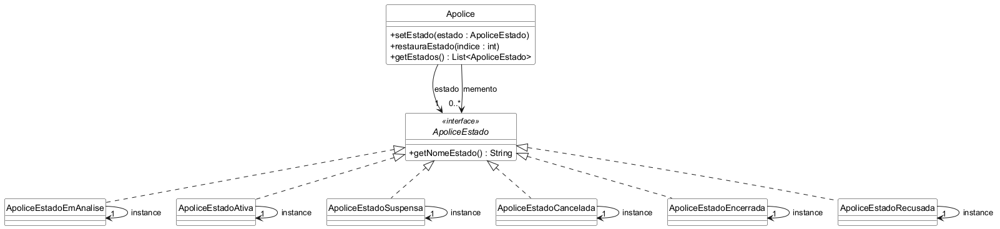

# Memento

Trabalho da disciplina Aspectos Avançados em Engenharia de Software.

Exemplo do padrão Memento em Java, com testes em JUnit 5. O tema é o mesmo da
seguradora usada nos trabalhos anteriores: a apólice passa por vários estados
(em análise, ativa, suspensa, cancelada, encerrada e recusada), e a seguradora
precisa guardar o histórico para poder voltar a um estado anterior.

Toda vez que o estado da apólice muda, ele é guardado numa lista. Com o
`restauraEstado` dá para voltar para qualquer estado do histórico, passando a
posição dele na lista.

## Diagrama de classes

